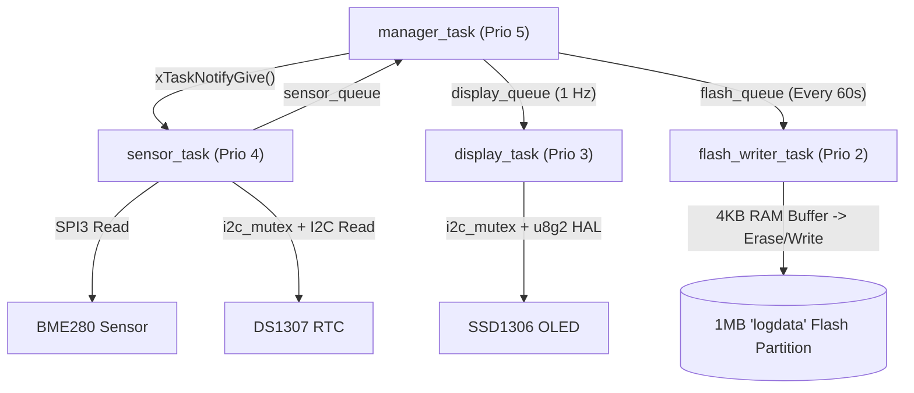

# RTOS Environmental Flash Data Logger (ESP32-S3)

An event-driven, multithreaded environmental data logger built on the **ESP32-S3** using **ESP-IDF (v5.5)** and **FreeRTOS**. The system samples temperature, humidity, and atmospheric pressure via SPI, timestamps records using an external RTC over a mutex-protected I2C bus, displays real-time telemetry on an OLED dashboard, and performs wear-aware buffered logging directly to a custom raw SPI Flash partition.

---

## 🎥 Video Demonstration

[](https://drive.google.com/file/d/1RtpV6dzjDXBuI2syLouHdj-MUfGcflbh/view?usp=sharing)

> 🔗 **Video Link:** [Watch the Hardware & Firmware Demo on Google Drive](https://drive.google.com/file/d/1RtpV6dzjDXBuI2syLouHdj-MUfGcflbh/view?usp=sharing)

---

## ⚙️ Key Technical Features

- **Multi-Tasking FreeRTOS Architecture:** Designed around 4 prioritized concurrent tasks (`manager_task`, `sensor_task`, `display_task`, `flash_writer_task`) synchronized via **Direct Task Notifications**, **Message Queues**, and a **Mutex**.
- **Wear-Aware Raw Flash Storage:** Implements a 4 KB RAM sector buffer that accumulates compact 10-byte binary records (`#pragma pack(1)`) and flushes them in aligned 4096-byte blocks to a custom `logdata` flash partition (`esp_partition` API), minimizing flash erase-write cycles.
- **Bare-Metal SPI Sensor Driver (`env_spi`):** Interfaces a **BME280** sensor in forced mode over **SPI3 (1 MHz)** using 64-bit integer / fixed-point Bosch compensation algorithms (`Q24.8` for pressure, `Q22.10` for humidity) with zero floating-point overhead during raw compensation.
- **Thread-Safe Shared I2C Bus (`i2c_bus`):** Arbitrates concurrent access between the **DS1307 RTC** (`0x68`) and **SSD1306 128x64 OLED** (`0x3C`, driven via a custom `u8g2` ESP-IDF v5 `i2c_master` HAL) using a FreeRTOS mutex (`i2c_mutex`).
- **Real-Time OLED Dashboard & Boot Animation:** Features a custom XBM bitmap boot animation followed by a live status screen displaying `HH:MM:SS`, environmental metrics (`°C`, `%`, `mmHg`), and flash storage state (`STATUS: LOGGING` / `STATUS: FLASH FULL!`).

---

## 🔌 Hardware & Pinout Configuration

| Peripheral | Interface | ESP32-S3 Pins / Address | Description |
| :--- | :--- | :--- | :--- |
| **BME280** | SPI (`SPI3_HOST`) | `SCLK`: GPIO 5, `MOSI`: GPIO 6, `MISO`: GPIO 16, `CS`: GPIO 17 | Temperature, Humidity & Pressure Sensor (1 MHz, Mode 0) |
| **DS1307 RTC** | I2C (`I2C_NUM_0`) | `SDA`: GPIO 8, `SCL`: GPIO 9 (`0x68`) | Real-Time Clock with BCD-to-decimal hardware conversion |
| **SSD1306 OLED** | I2C (`I2C_NUM_0`) | `SDA`: GPIO 8, `SCL`: GPIO 9 (`0x3C`) | 128x64 Monochrome Display (`u8g2` library + custom HAL) |
| **Internal Flash** | SPI Flash (`MMU`) | Custom Partition `logdata` (1 MB) | Raw binary sector-buffered storage (`partitions.csv`) |

---

## 🧩 System Architecture & Data Flow



### Binary Log Record Format (10 Bytes, Packed)
To maximize storage capacity on the 1 MB `logdata` partition (~104,857 records total), telemetry is serialized into a tightly packed C structure before buffering:

```c
#pragma pack(push, 1)
typedef struct {
    uint32_t timestamp;  // Seconds since midnight (RTC)
    int16_t  temp;       // Temperature in °C * 100
    uint16_t hum;        // Relative Humidity in % * 100
    uint16_t press;      // Atmospheric Pressure in mmHg
} log_record_t;          // Total: 10 bytes per record
#pragma pack(pop)
```

---

## 📁 Project Structure

```text
Low_Power_Logger/
├── main/
│   ├── main.c                  # FreeRTOS tasks, queues, mutex & flash sector buffering
│   └── CMakeLists.txt
├── components/
│   ├── env_spi/                # SPI3 master driver & fixed-point compensation for BME280
│   ├── i2c_bus/                # Shared I2C master bus initialization (ESP-IDF v5 API)
│   ├── rtc_ds1307/             # DS1307 RTC driver with BCD conversion
│   └── oled_display/           # SSD1306 UI dashboard, XBM boot animation & u8g2 HAL
├── partitions.csv              # Custom partition table with 1MB 'logdata' region
└── CMakeLists.txt
```

---

## 🚀 Getting Started (Build & Flash)

### Prerequisites
- **ESP-IDF v5.x** (tested on v5.5.4)
- **ESP32-S3** development board

### Build and Flash Commands
```bash
# Set target to ESP32-S3
idf.py set-target esp32s3

# Build the project (compiles firmware and custom partition table)
idf.py build

# Flash to board and open serial monitor
idf.py -p PORT flash monitor
```
